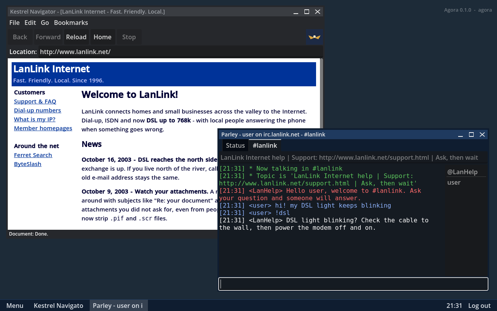
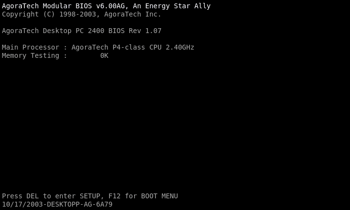
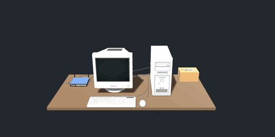
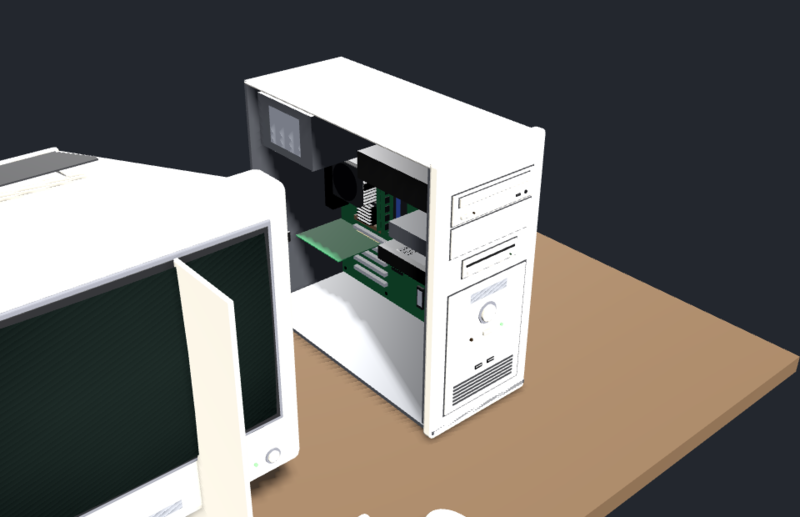
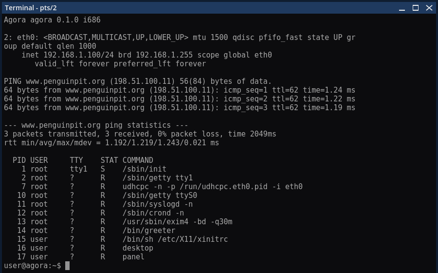
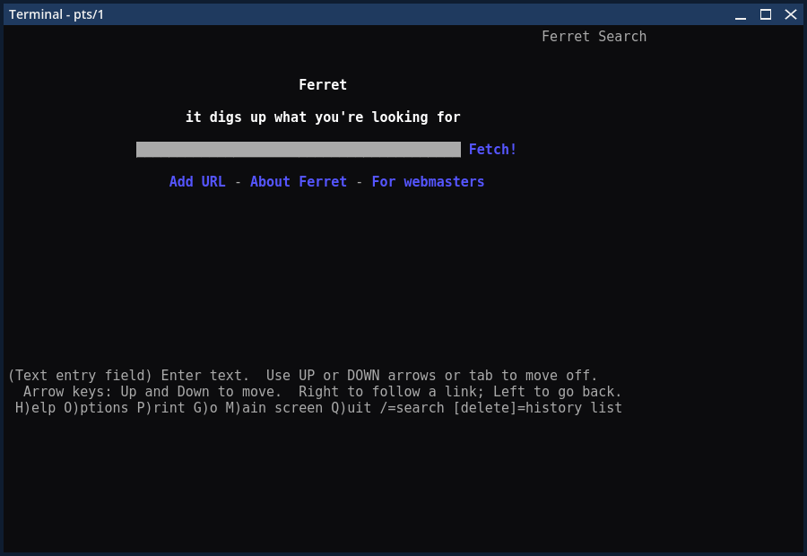
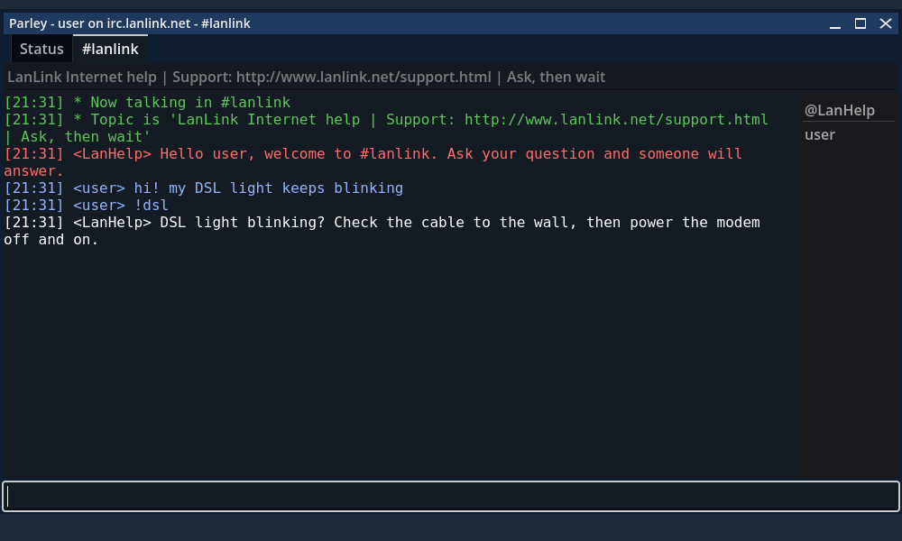

# AgoraOS

A Unix-like operating system simulated in Godot 4.7: a virtual file system,
users and permissions, processes, pipes and a shell, with an X11-style
graphics layer on top. It is designed to be embedded in games.



Every machine boots for real: BIOS, GRUB, the kernel, init, a login prompt.



The world is a small internet of 2003, simulated inside Godot (no real
network). The machines are cabled together and can be looked at in 3D, down
to the cards inside the case.

<p>


</p>

<p>


</p>



MIT licensed; see [LICENSE](LICENSE) and [CREDITS.md](CREDITS.md).

The addon is `addons/agora_os/`; copy that folder into a project to use it.
The rest of the repository is the demo (`main.gd`, `worlds/`, the 3D models
in `assets/`), the tests, the tools and the documentation. The 3D view looks
for models in `res://assets` (`AgoraHardwareView3D.model_dir`); without them
it shows only the models it builds itself.

## Try it

Run the project (`godot --path .`, or press F5 in the editor). You get the
world in `worlds/home.tres`, an evening in October 2003: a PC with a monitor
and a home router, cabled to a small internet. The provider (LanLink) hands
the router an address and runs the name server; behind its switch are web
servers with era sites (the provider's portal and member homepages, a Linux
user group, a geek news site, an e-zine, a demoscene site with anonymous
FTP) and Ferret, a search engine whose crawler really walks those sites.
Try `lynx www.ferret.org`.

The first time, the PC is empty with the install CD in its drive, and the
installer runs on the text console (pick DHCP for the network). Start with
`godot --path . -- --preinstalled` to skip that and log in as `user` /
`user`. Boxes without a monitor are reached through their serial console. The
bar at the top switches between the boxes, like a KVM switch (Scroll Lock
does the same), and has their power buttons. The whole world, every disk and
cable included, is saved to `user://worlds/home.agw` when you close the
window; delete that file to start over.

Or use the console front end, with no GUI:

```sh
godot --headless --path . -s tools/repl.gd            # resume its saved machine
godot --headless --path . -s tools/repl.gd -- --fresh # start over
```

You log in as `user` (password `user`, allowed to use sudo). The root password
is `root`. Another machine is cabled to eth0: `ssh admin@server.lan` (10.0.0.7),
password `admin`. A machine saved before networking existed has no network
configuration; start with `--fresh` to get one.

## Tests

```sh
godot --headless --path . -s tests/run_tests.gd
```

## Docs

- [docs/README.md](docs/README.md): the documentation, chapter by chapter
- [docs/ROADMAP.md](docs/ROADMAP.md): what is done and what comes next
- [docs/reference/programs.md](docs/reference/programs.md): every program and package
